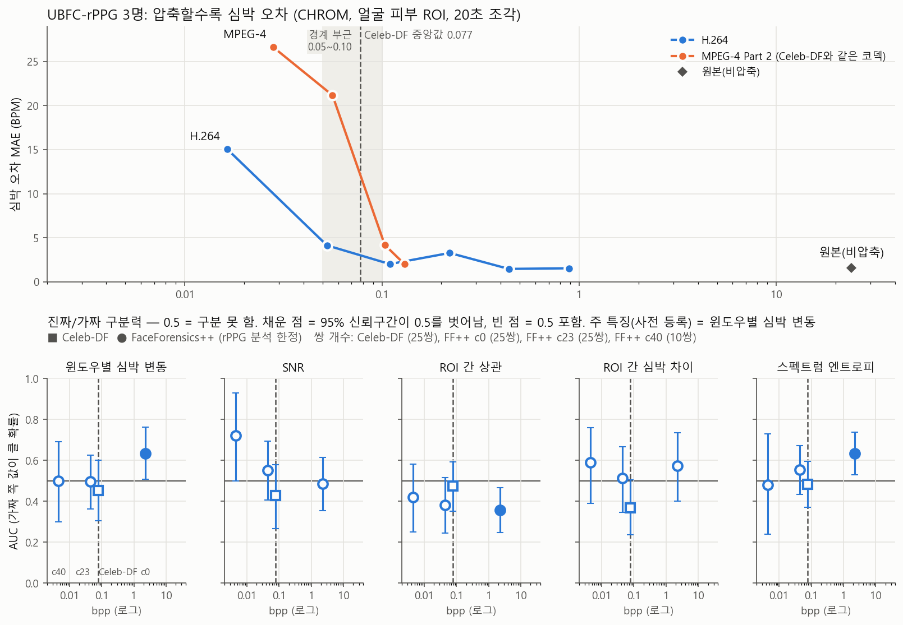

# 딥페이크 탐지기 — 백엔드 구현 진행 계획 (Claude Code 인계용)

2026년도 심화응용프로젝트(인하공업전문대학 컴퓨터시스템공학과). rPPG 생체신호 교차검증 기반 영상 진위 판별 시스템의 **백엔드와 분석 파이프라인**을 만드는 계획이다.
프론트엔드(React 대시보드)는 목 API(MSW)로 화면 7개가 완성된 상태이고, 이 백엔드가 그 목 API를 대체한다.

이 문서는 작업 순서와 이미 정해진 결정을 적은 것이다. **"미결정 사항"에 있는 항목은 임의로 정하지 말고 사용자에게 확인한다.**

---

## 1. 기준 문서

| 문서 | 역할 |
|---|---|
| 상세제안서 4장 (기능 1~8) | 기능 정의의 기준 |
| 화면설계서 v1.3 (2026-09-29 제출) | 화면과 API 7개의 기준 |
| 프론트엔드 저장소 `src/types/api.ts` | **API 요청·응답 형식의 기준.** 백엔드 응답은 이 타입과 정확히 맞아야 한다 |
| 프론트엔드 저장소 `src/mocks/` | 각 엔드포인트가 어떤 값을 돌려줘야 하는지 보여주는 예시 |

API 형식을 바꿔야 할 것 같으면 바꾸기 전에 사용자에게 알린다(프론트엔드와 함께 고쳐야 한다).

## 2. 확정된 결정

### 메인 모델
- **DeepfakeBench의 EfficientNet-B4 사전학습 가중치** (`effnb4_best.pth`, 릴리스 v1.0.1, 67.7 MB)
  - https://github.com/SCLBD/DeepfakeBench/releases/tag/v1.0.1
- 새로 학습하지 않고 **추론만** 한다. 노트북 **CPU**에서 영상 1편을 분석할 수 있어야 한다.
- **DeepfakeBench 전체를 설치하지 않는다.** 이 저장소는 Python 3.7 기준이다. 모델 구조 코드(`training/detectors/efficientnetb4_detector.py`와 관련 설정)만 가져와 우리 환경(Python 3.10)에서 가중치를 불러온다.
- 메인 모델에 넣는 얼굴은 **DeepfakeBench 전처리와 같은 방식으로 자른다**(dlib 81 랜드마크 기반 정렬, 256×256). 학습 때와 다르게 자르면 정확도가 떨어진다.
  - 랜드마크 파일: https://github.com/SCLBD/DeepfakeBench/releases/download/v1.0.0/shape_predictor_81_face_landmarks.dat

### 데이터셋
- **FaceForensics++: rPPG 특징 분석 한정 허용. 메인 모델·융합·5단계 최종 평가에는 사용 금지** (2026-10-19 변경).
  메인 모델의 학습 데이터라서 메인 모델·융합 평가에 쓰면 성능이 부풀려진다. rPPG 특징만 보는 분석에는 메인 모델이 들어가지 않고,
  같은 영상이 c0/c23/c40 압축 단계로 있어 압축 강도별 분석에 쓴다. 위치 `D:\Deepfake_Datasets\FaceForensics++`
  (original_sequences/youtube, manipulated_sequences/Deepfakes, 각 raw·c23·c40 10편). 메인 모델은 FF++에 돌리지 않는다.
- **주 데이터셋: Celeb-DF v2** (Celeb-real 590 / Celeb-synthesis 5,639 / YouTube-real 300)
  - `List_of_testing_videos.txt`의 **518개는 최종 평가 전용이다.** rPPG 분류기 학습, α 결정, 특징 기준값 산출 등 어떤 단계에도 쓰지 않는다.
  - 나머지 영상은 **인물 단위로** 학습/검증 세트를 나눈다(같은 인물이 양쪽에 들어가지 않게).
- 추가 데이터(나중에, 선택): DFDC Kaggle 샘플(두 번째 평가 세트), AI Hub 딥페이크 변조 영상 일부(한국인 얼굴, 조명 메타데이터로 SQI 검증).
- **rPPG 정확도 검증용: UBFC-rPPG** (4단계에서 추가, 2026-10-19)
  - 출처: https://sites.google.com/view/ybenezeth/ubfcrppg (Benezeth 연구실, 페이지의 Google Drive 링크). "연구 목적으로 공유"이며 별도 라이선스 문구는 없다.
  - 인용: S. Bobbia, R. Macwan, Y. Benezeth, A. Mansouri, J. Dubois, "Unsupervised skin tissue segmentation for remote photoplethysmography", Pattern Recognition Letters, 2017.
  - 쓰는 것: DATASET_2(realistic)의 subject47·48·49 (웹캠 640×480 약 30fps, 비압축 AVI, 편당 약 1.8GB, 약 68초). 위치 `D:\Deepfake_Datasets\UBFC-rPPG\DATASET_2\subjectNN\`.
  - `ground_truth.txt`: 3줄 — 1줄 손가락 PPG 파형, 2줄 맥박 측정기(CMS50E) 심박수(BPM), 3줄 시각(초). 세 줄 모두 영상 프레임마다 값 하나.
  - 정답 심박이 있어 "심박을 정확히 뽑았는지"를 확인하는 용도로만 쓴다(딥페이크 판별 학습·평가에는 쓰지 않음).
  - **실제 사람 얼굴이므로 Celeb-DF와 같은 규칙: 얼굴이 담긴 이미지를 저장소·문서에 넣지 않는다.**
- 데이터셋과 가중치는 **저장소 밖**에 두고 경로는 환경변수로 받는다(예: `DATASET_DIR`, `MODEL_DIR`). Git에 올리지 않는다.

### 기술 스택 (상세제안서 기준)
- Python 3.10, FastAPI, Celery + Redis, SQLite(SQLAlchemy), OpenCV, MediaPipe, NumPy, SciPy, scikit-learn, PyTorch
- 개발 PC는 Windows다. Redis와 Celery는 Windows를 공식 지원하지 않으므로 **Docker(docker compose)로 띄운다.**
- **MediaPipe 설치 방식 (4단계, 2026-10-19)**: `mediapipe==0.10.21`을 **의존성 없이(`--no-deps`)** 설치하고, 실제로 필요한
  의존성만 `backend/requirements-rppg.txt`에 고정한다(absl-py, attrs, flatbuffers, protobuf<5, matplotlib, scipy).
  - 이유: mediapipe의 의존성 목록에 `opencv-contrib-python`이 있어 그대로 설치하면 기존 `opencv-python-headless`(cv2)를 덮어쓴다(4.10 → 4.11로 바뀌는 것 확인).
  - 0.10.21을 고른 이유: solutions API의 Face Mesh가 있고 랜드마크 모델이 패키지에 내장돼 있다(최신 1.x는 Tasks API만 있고 모델 파일을 따로 받아야 함).
  - **`requirements.txt`의 `numpy==1.26.4` 고정은 풀면 안 된다.** mediapipe 0.10.21은 numpy<2가 필요한데, `--no-deps`로 설치하면 pip가 이 제약을 모른다.
  - SciPy는 직접 구현한 신호 처리를 비교하는 시험(`scripts/check_dsp.py`)에만 쓴다.

### rPPG
- CHROM/POS, Butterworth 대역통과, Welch 스펙트럼은 **직접 구현한다**(프로젝트의 차별점). pyVHR 등 외부 라이브러리는 결과 비교·검증용으로만 쓴다.
- ROI 추적은 MediaPipe Face Mesh(이마·좌볼·우볼).
- Butterworth는 **2차 구간(SOS)** 방식으로 설계·적용한다(4단계에서 정함). 저역 차단 0.7Hz처럼 낮으면 계수 하나짜리(b, a) 방식은
  수치적으로 불안정하다 — 60fps·8차에서 (b, a) 방식은 발산했다(SOS 대비 차이 5.6e+29).
- **설계 변경 — 윈도우별 심박의 윈도우 길이: 3초 → 6초 또는 8초** (제출한 화면설계서는 3초, 2026-10-19).
  3초 윈도우는 주파수 해상도가 1/3Hz(20BPM)라 윈도우별 심박과 변동성 특징이 의미가 없다. 1초 간격으로 옮기며, 스펙트럼을
  0.01Hz 간격으로 계산(zero-padding)하고 피크를 포물선 보간한다. 6초·8초 중 최종값은 소규모 검증 결과를 보고 정한다.
  화면의 "3초 윈도우 BPM" 문구(프론트엔드)도 정해진 값으로 바꾼다. API 형식(`WindowBpm`)은 그대로다.
- SNR 정의: de Haan & Jeanne(2013, CHROM 논문) 방식 — 심박 f0 ± 0.1Hz와 2·f0 ± 0.2Hz 안의 파워 ÷ 0.7~4Hz 안 나머지 파워(dB).
  정답이 없는 영상에서는 f0가 추정값이라 '정확도'가 아니라 '신호가 깨끗한 정도'다.

## 3. 미결정 사항 (임의로 정하지 말고 확인)

| 항목 | 현재 상태 |
|---|---|
| P_rppg의 방향 | 프론트는 "1에 가까울수록 가짜"로 가정. 확정 필요 |
| S가 0.4~0.6이고 두 축이 상충하지 않을 때의 판정 | 문서에 정의 없음 |
| 임계값(S 0.4/0.6, 상충 임계, SQI 하한), α, SQI 등급 기준 | 전부 예시값. 실험으로 확정 → **설정 파일 한 곳에 모아 두고 코드에 박지 않는다** |
| 특징 6개의 "실제 얼굴 기준" 값 | 예시값. Celeb-DF 학습 세트의 진짜 영상 분포로 산출할 예정 |
| 이력 조회 쿼리 파라미터 이름, 일괄 삭제 본문, 오류 상태 코드 | 프론트 저장소에서 제안한 값. 백엔드 담당과 합의 필요 |
| 리포트 ZIP 일괄 내보내기 엔드포인트 | 화면설계서에 없음 |

## 4. 단계별 진행

각 단계는 **완료 기준**을 만족하고 사용자에게 결과를 보고한 뒤 다음 단계로 넘어간다.

### 0단계 — 사전 확인 (코드 작성 전)
1. DeepfakeBench 저장소의 EfficientNet-B4 설정 파일과 학습 설정을 읽고, `effnb4_best.pth`가 **어떤 데이터로 학습됐는지** 확인한다(FF++의 압축 버전, 다른 데이터 포함 여부).
   - **Celeb-DF가 학습에 포함돼 있으면 즉시 멈추고 사용자에게 보고한다.** 데이터셋 계획이 바뀐다.
2. Celeb-DF 압축 해제 상태를 확인한다(영상 개수 590 / 5,639 / 300, `List_of_testing_videos.txt` 존재).
- 완료 기준: 위 두 가지 확인 결과를 사용자에게 보고.

### 1단계 — 메인 모델 단독 추론 스크립트 (웹 없이)
- 영상 1편 → 프레임 샘플링 → 얼굴 검출·정렬·자르기 → EfficientNet-B4 → 프레임별 조작 확률
- 상·하위 이상치 제거 후 시간축 평균(P_model)과 분산, 구간별 점수 프로파일 산출(기능 3)
- Celeb-DF **평가 세트가 아닌** 영상 중 진짜 5개·가짜 5개로 실행해 결과가 상식적인지 확인한다.
- 완료 기준: 명령 한 줄로 영상 1편의 P_model·분산·구간 프로파일이 출력되고, CPU에서 걸린 시간을 보고.

#### 1단계 결과 (2026-10-08 완료)
- 코드: `backend/analysis/`(settings, effnb4, face_align, main_model), 실행 `backend/scripts/run_main_model.py`.
  실행 명령은 루트 `CLAUDE.md`에 있다.
- Celeb-DF 평가 세트 밖 진짜 5개·가짜 5개 (영상당 32프레임, 이상치 제거 위·아래 각 10%):

  | | 개수 | P_model 평균 | 0.5 기준 정답 | 비고 |
  |---|---|---|---|---|
  | 진짜 (Celeb-real) | 5 | 0.322 | 4/5 | 0.115 ~ 0.509 |
  | 가짜 (Celeb-synthesis) | 5 | 0.865 | 5/5 | 0.532 ~ 0.998 |

  - 10개 중 3개(진짜 0.509·0.471, 가짜 0.532)가 0.4~0.6 경계 구간에 있었고, 이 영상들은 프레임별 점수의 표준편차가 0.2 이상으로 컸다.
  - 10개 표본이므로 성능 수치로 쓰지 않는다. 방향이 상식적인지(진짜 낮음·가짜 높음)만 확인한 것이다.
- 처리 시간 (노트북 CPU, Intel Core Ultra 5 228V 8코어): 처음 37초 → 속도 실험 후 **약 25초**.
  - 처음: 8장씩 묶어 넣었을 때 영상 1편 평균 37초(얼굴 검출·정렬 약 5초, 모델 계산 약 31초). 모델 불러오기 1.3초(서버에서는 한 번만).
  - 속도 실험(32장 처리 시간, 발열 영향을 줄이려고 조건을 번갈아 3라운드 측정한 중앙값):

    | 조건 | 시간 | 결과 |
    |---|---|---|
    | 8장씩 (처음) | 26.1초 | 기준 |
    | **32장 한 번에** | **20.5초** | **약 20% 빠름 → 적용** |
    | 32장 + 일반 Swish | 21.2초 | 추가 이득 없음 |
    | 32장 + 일반 Swish + channels_last | 20.8초 | 추가 이득 없음 |
    | inference_mode (no_grad 대신) | — | 차이 없음(측정 오차 범위) |
    | 스레드 4 / 6 / 8 | 43.7 / 37.1 / 34.6초 | 기본값 8(코어 수 전부)이 가장 빠름 → 그대로 |

  - 배치 32 적용 후 같은 영상 3개: P_model 값은 그대로, 영상 1편 22.9~25.6초(모델 계산 18~20초).
  - 노트북은 10분 이상 계속 돌리면 발열로 느려진다(같은 조건이 28.5초 → 34.6초). 속도를 비교할 때는 조건을 번갈아 측정해야 한다.
- 정한 것:
  - 얼굴 정렬은 DeepfakeBench와 같은 방식(dlib 81점 중 5점, 유사 변환, 1.3배 여백, 256×256). 유사 변환 추정은 scikit-image 대신
    NumPy로 직접 구현했다(같은 Umeyama 방법, 무작위 1,000건 비교 시 최대 차이 0.00025).
  - 검출 규칙도 DeepfakeBench와 같다: 가장 큰 얼굴 하나만 쓰고, 정렬 후 다시 검출되지 않는 프레임은 버린다.
  - 구간 프로파일(2초 단위)에서 얼굴이 없는 구간은 뺀다(API `ModelSegment.p`가 빈 값을 허용하지 않음).
  - 프레임 수 32(DeepfakeBench 기본값), 한 번에 넣는 얼굴 수 32, 이상치 제거 10%, 구간 2초는 `backend/analysis/settings.py`에 있다.
    10%·2초는 예시값.
- 처리 시간은 당분간 그대로 둔다. 프레임 수 변경이나 CPU 가속 라이브러리 도입은 필요해지면 다시 정한다.

### 2단계 — 백엔드 골격
- FastAPI로 엔드포인트 7개를 `src/types/api.ts`와 같은 형식으로 구현
- SQLite 테이블 설계·생성(작업 정보, 판정 결과, 근거 데이터, 분석 불가 사유, 검토자 판단). 파형·스펙트럼 같은 큰 배열은 JSON으로 저장
- Celery 워커가 5단계(업로드·검증 → 전처리·ROI → 메인 모델 ∥ rPPG → 융합)를 진행하며 Redis에 진행률을 기록
- 이 단계에서 메인 모델·rPPG는 **더미 값**을 돌려준다. 더미임을 코드와 응답에서 명확히 표시한다.
- docker compose로 API·워커·Redis를 한 번에 실행
- 완료 기준: 프론트를 `VITE_USE_MOCK=false`로 바꿔 업로드 → 진행 → 결과 → 이력 흐름이 실제 백엔드로 동작.

#### 2단계 결과 (2026-10-09 완료)
- 구성 (실행 방법은 루트 `CLAUDE.md`):

  | 위치 | 내용 |
  |---|---|
  | `docker-compose.yml` | Redis + API 서버(FastAPI, 8000번) + 워커(Celery, 한 번에 작업 1개). DB·업로드 영상은 Docker 볼륨 `app-data` |
  | `backend/requirements-api.txt` | FastAPI, uvicorn, python-multipart, SQLAlchemy, Celery, redis. dlib이 든 `requirements.txt`와 나눠 빌드 시간을 줄임 |
  | `backend/app/` | `api.py`(API 7개), `schemas.py`(= `frontend/src/types/api.ts`), `models.py`·`db.py`(SQLite 테이블 5개, WAL), `progress.py`(Redis 진행률), `tasks.py`(5단계 작업), `worker.py`, `serializers.py`, `config.py` |
  | `backend/analysis/` | `fusion.py`(융합 판정 규칙), `video_meta.py`(영상 정보), `dummy.py`(더미 시나리오), `settings.py`에 임계값·더미 설정 추가 |

- 확인한 것: 프론트엔드를 목 없이 붙여 화면 7개(업로드·진행·결과·근거·분석 불가·판단 보류·이력)가 모두 실제 백엔드로 동작.
  취소(대기 중·진행 중), 삭제(단건·일괄, 진행 중 포함), 검토 저장·수정, 이력 필터 전부, 오류 응답(404·409·422) 확인.
- 정한 것:
  - **더미 모드**(`USE_DUMMY_ANALYSIS`, 기본 켜짐): 점수는 파일명 키워드로 고른 예시 값(`fake` / `hold` / `fail`·`noface` / `lowsqi`, 그 외 진짜).
    해석 문장·단계 로그·분석 불가 제목 앞에 `[더미]`. 판정은 더미 점수에도 실제 규칙(`fusion.py`)을 적용한다.
  - 더미 모드에서도 업로드·검증은 실제로 한다: 열 수 없으면 '파일 손상', 10초 미만이면 '길이 부족'으로 분석 불가.
  - 미결정인 "S 0.4~0.6 + 비상충" 판정은 `settings.BOUNDARY_VERDICT = 'real'`(프론트 목과 같은 예시값).
  - 진행 중 기록은 Redis, 끝난 작업의 상태·로그는 DB(`jobs.stages`, `jobs.logs`). 판정에 쓴 임계값을 결과와 함께 저장한다.
  - 이력 저장을 끈 작업은 DB에 남기되 이력 목록에서 뺀다. 이력 기간 필터는 UTC 날짜 기준(프론트 목과 같음).
  - 진행 중인 작업을 삭제하면 먼저 취소 표시를 남겨, 워커가 지워진 작업에 쓰지 않고 멈추게 한다.
  - 리포트 PDF는 빈 1쪽 PDF(자리만). PDF 라이브러리는 나중에 정한다.
  - 테이블 구조를 바꾸면 개발 중에는 `docker compose down -v`로 볼륨을 지우고 새로 만든다(마이그레이션 도구 없음).
- 진행하며 바꾼 것:
  - 판단 보류의 검토 상태를 셋으로 나눔: '재검토' → **검토 대기**(기록 없음) / **추가 검토 필요** / **검토 완료**.
    API `ReviewState`에 `needs_more_review` 추가(`api.ts` → 목 → 백엔드 함께 수정).
  - 워커 로그에 단계 시작·완료·최종 상태를 한 줄씩 남기도록 함(`docker compose logs -f worker`로 진행을 볼 수 있게).
  - 브라우저로 녹화한 WebM은 프레임률이 저장되지 않아 OpenCV가 1000fps·프레임 수를 엉뚱하게 알려 준다.
    `video_meta.py`가 이 경우 프레임을 직접 세어 계산하도록 고침(11초 영상이 1000fps → 28.8fps).
- 3단계로 넘길 것:
  - `analysis/main_model.py`의 프레임 뽑기도 fps·프레임 수를 OpenCV 값 그대로 쓴다. 실제 모델을 연결할 때 `video_meta.py`와 같은 방식으로 바꾼다.
- 나중에 정할 것: 자동 정리(업로드 원본 보관 기간 — 화면설계서 UC-15, 이력 저장을 끈 작업·취소된 작업 정리). Celery beat로 새 라이브러리 없이 가능.

### 3단계 — 메인 모델 연결
- 1단계 스크립트를 워커의 메인 모델 단계에 연결한다.
- 완료 기준: 실제 영상을 올리면 화면에 실제 P_model과 구간 프로파일이 표시됨.

#### 3단계 결정 사항 (2026-10-17)
- **rPPG는 3단계 동안 더미를 유지한다.**
  - 파일 이름에 키워드(`fake` / `hold` / `fail`·`noface` / `lowsqi`)가 **없으면** 더미 P_rppg = P_model로 둔다.
    그러면 S = P_model이 되어 판정이 메인 모델과 같고, 판단 보류가 나오지 않는다(더미 rPPG가 판정을 바꾸지 않게).
  - 키워드가 **있을 때만** 지금처럼 더미 시나리오의 rPPG 값으로 동작한다(판단 보류·신호 품질 낮음 화면 확인용).
  - rPPG 쪽 문구의 `[더미]` 표시는 유지한다.
- **얼굴 검출률 기준(메인 모델용)**: 뽑은 프레임 중 얼굴이 잡힌 비율이 80% 미만이면 분석 불가(`FACE_NOT_DETECTED`). 80%는 화면설계서
  예시에서 가져온 예시값이며 `analysis/settings.py`에 둔다. **이 기준은 메인 모델 입력용이고, rPPG용 얼굴 기준(연속 구간 길이 등)은 4단계에서 따로 정한다.**
  → 3-6에서 **70%로 낮췄다**(아래 3단계 결과). 여전히 예시값이다.
- 분석마다 얼굴 검출률(잡힌 프레임 수 / 뽑은 프레임 수)을 결과에 기록한다.
- 3-6 확인 때 Celeb-DF 외에 직접 찍은 웹캠·휴대폰 영상도 넣어서 80%가 빡빡한지 본다.
- 진행 순서: 3-1 이미 끝난 작업이 다시 실행되는 버그 수정 → 3-2 더미 설정 분리 → 3-3 메인 모델 코드 손보기(fps, 진행률, 얼굴 통계)
  → 3-4 워커 연결 → 3-5 해석 문장 → 3-6 확인 → 3-7 기록·커밋.

#### 3단계 결과 (2026-10-18 완료)
- 바꾼 것:

  | 위치 | 내용 |
  |---|---|
  | `analysis/main_model.py` | `prepare`(프레임 추출·얼굴 정렬) + `score`(EfficientNet-B4)로 나눔. fps·프레임 수는 `video_meta.py` 값을 씀(WebM 1000fps 문제). 진행률 알림, 얼굴 검출 통계(잡힌 수·얼굴 없음·재검출 탈락·평균 얼굴 크기·원본 재시도 수·평균 밝기) |
  | `analysis/face_align.py` | 실패 이유·얼굴 크기를 함께 돌려줌. 얼굴 **찾기**만 긴 변 960px로 줄인 사본에서 하고, 못 찾으면 원본에서 다시 찾음. 랜드마크·정렬은 원본 해상도 |
  | `analysis/interpret.py` (새 파일) | 해석 문장·두 축 대조 문장을 실제 점수와 settings.py 임계값으로 만듦 |
  | `app/tasks.py` | 워커가 모델을 한 번만 불러 두고 실제 메인 모델로 분석. 얼굴 검출률 기준 미달이면 모델 계산 없이 분석 불가(측정값으로 안내). 메인 모델 처리 시간·PyTorch 스레드 수를 진행 로그에 남김 |
  | `app/models.py`, `app/db.py` | `jobs.face_frames_sampled`, `jobs.face_frames_detected` 추가. 서버 시작 때 칸이 없으면 `ALTER TABLE`로 붙임(이미 있으면 넘어감 — API·워커 동시 시작 대비). `down -v` 불필요 |
  | `analysis/settings.py` | `USE_DUMMY_MAIN_MODEL` 기본 끔. `MAIN_MODEL_MIN_FACE_RATE 0.7`, `MAIN_MODEL_DETECT_MAX_SIDE 960`, `FACE_SMALL_PX 100`, `DARK_BRIGHTNESS 60`(안내 문구용) — 전부 예시값 |

- **확인 ① Celeb-DF 40편** (진짜 20·가짜 20, 시드 1. `List_of_testing_videos.txt` 518개와 겹치는 영상 0개 확인, 1단계 10편과도 겹치지 않음)

  | | P_model 평균 | 범위 | 경계 구간(0.4~0.6) | 0.5 기준 정답 |
  |---|---|---|---|---|
  | 진짜 | 0.311 | 0.045 ~ 0.669 | 3편 | 17/20 |
  | 가짜 | 0.726 | 0.140 ~ 0.997 | 5편 | 17/20 |

  - 영상 단위 AUC **0.907**(400쌍). 40편 표본이라 성능 수치로 쓰지 않는다.
  - 틀린 6편: 진짜 id17_0007 0.669 · id23_0006 0.653 · id40_0000 0.658 / 가짜 id16_id20_0011 0.474 · id51_id58_0005 0.475 · id37_id3_0003 0.140.
  - 얼굴 검출률: 40편 모두 93.8% 이상(1,280장 중 얼굴 없음 6장·재검출 탈락 2장). 얼굴 크기 88~299px.

- **확인 ② 직접 찍은 셀카 영상 5편** (휴대폰 전면 카메라, 1080×1920 세로, HEVC Main 8비트, 20~24초. 현재 설정 960px 기준)

  | 영상 | 얼굴 검출률 | 평균 얼굴 | 평균 밝기 | P_model | 결과 |
  |---|---|---|---|---|---|
  | 01 정면 | 31/32 | 500px | 77 | **0.940** | 가짜 판정 |
  | 02 고개 좌우로 돌림 | 25/32 (78.1%) | 472px | 77 | **0.734** | 가짜 판정 (80%였으면 분석 불가) |
  | 03 팔 길이 거리 | 30/32 | 470px | 80 | **0.758** | 가짜 판정 |
  | 04 1~2m 거리 | 32/32 | 165px | 92 | 0.525 | 경계 구간 → 진짜(예시 규칙) |
  | 05 어두운 방 | 1/32 | – | 30 | – | 분석 불가(어두움 안내) |

- **핵심 발견: 같은 "진짜 영상"인데 Celeb-DF는 20편 중 17편이 0.5 미만, 셀카는 0.53~0.94.**
  메인 모델 단독으로는 휴대폰 셀카 영상을 가짜로 오판할 수 있다.
  - 원인 확인(코드 버그 여부를 단정하지 않고 본 것):

    | 확인 | 결과 |
    |---|---|
    | HDR 여부 (MP4의 `hvcC`·`colr` 정보를 직접 읽음, ffprobe 대신) | 5편 모두 HEVC **Main 8비트**, HDR 색 정보(HLG/PQ) 없음 → HDR로 색을 잘못 읽는 문제는 아님 |
    | 정렬된 얼굴 (01 영상 6장을 `backend/out/aligned_01/`에 저장, git 제외) | 눈·코·입이 기준 위치, 색도 정상(RGB 순서 맞음). 얼굴이 프레임 가장자리에 가까운 장면은 정렬 후 가장자리에 검은 띠가 생김(DeepfakeBench도 같은 방식) |
    | 720p로 다시 인코딩 (컨테이너 OpenCV에 H.264 인코더가 없어 Celeb-DF와 같은 MPEG-4 Part 2로) | 01: 0.940 → 0.907, 03: 0.758 → 0.716 |
    | 재인코딩 없이 프레임만 720p로 줄임 | 01: 0.945, 03: 0.809 |

    → 해상도·코덱으로는 설명되지 않는다. 남은 후보: 전면 카메라의 보정·잡음 제거 처리, 촬영 조건(가까운 거리·광각), 영상 전송 중 재압축(5편 모두 약 3.3Mbps로 휴대폰 원본치고 낮고 제조사 정보가 없음 — **카카오톡으로 옮긴 것으로 확인**, 원본이 아니라 메신저가 다시 압축한 영상이다), 학습 데이터(FF++)와의 차이.
    재압축은 rPPG(4단계)에도 불리하다. 이후 시험 영상은 USB 케이블 등 원본 그대로 옮기는 방법으로 받는다.
  - 얼굴 찾기 상자가 조금만 달라져도 P_model이 흔들린다(02: 원본에서 찾기 0.783 → 960px 0.734, 03: 0.720 → 0.758). 같은 영상의 점수가 ±0.05 정도 움직일 수 있다는 뜻이다.
  - **한계**: 셀카 5편은 한 사람·한 휴대폰으로 찍었다. 일반화할 수 없고, 웹캠·후면 카메라 영상은 사용자가 따로 찍어 추가 확인한다.

- **얼굴 찾기 크기 비교** (셀카 4편, 얼굴 정렬 시간 / 04 먼 거리 영상 검출률)

  | 찾기 크기 | 얼굴 정렬 시간 | 04 검출률 | 원본 재시도 |
  |---|---|---|---|
  | 원본(1080×1920) | 18~20초 | 32/32 | – |
  | 1280px | 9~13초 | 32/32 | 01·03 2장, 02 7장(얼굴이 없는 프레임) |
  | **960px (적용)** | **5~9초** | **32/32** | 04는 0장. 01 1장, 02 6장, 03 2장 |

  - 04 영상(얼굴 166px → 960px 사본에서 약 83px)도 줄인 사본에서 모두 찾았다. 못 찾는 프레임은 원본에서 다시 찾으므로 검출률이 떨어지지 않는다.
    대신 얼굴이 없는 영상(05)은 재시도 때문에 20초 → 25초로 늘었다.
  - Celeb-DF 프레임은 모두 960px 이하라 결과가 그대로다(1단계 10편 P_model 동일 확인).

- 처리 시간 (워커 안, 업로드→완료):
  - Celeb-DF 25.8~26.8초(모델 계산 17.2~18.1초). PyTorch 스레드는 워커 안에서도 8개(단독 실행과 같음).
  - 셀카(1080×1920) 44초 → 960px 적용 후 **28.5~29.5초**.
  - 1단계(약 21초)보다 긴 것은 더미 rPPG(2초)·융합 단계(2초)의 대기 시간이 더해졌기 때문이다.
- 그 밖에 확인한 것: 키워드 없는 영상은 S = P_model(두 축 차이 0, 판단 보류 없음). 얼굴 없는 영상은 전처리에서 바로 분석 불가.
  모델 계산 중 취소는 계산이 끝난 뒤 반영(최대 약 18초). WebM(브라우저 녹화)은 실제 fps(29.8)로 프레임을 고르게 뽑음.
- 정한 것:
  - 얼굴 검출률 기준 **70%**(예시값). 검출률은 작업마다 DB에 남기므로 **분포가 쌓이면 다시 정한다.**
  - 얼굴 찾기는 긴 변 960px 사본에서 하고, 못 찾으면 원본에서 다시 찾는다.
  - 분석 불가 안내의 "얼굴을 더 크게"는 평균 얼굴이 100px 미만이거나 한 번도 못 찾았을 때만, "영상이 어둡다"는 평균 밝기 60 미만일 때만 넣는다(예시값).
- 4단계로 넘길 것:
  - **가설(4단계에서 검증)**: rPPG 축이 메인 모델의 셀카 오판을 보완한다. 단, 셀카 보정·잡음 제거가 피부의 미세한 색 변화(rPPG 신호)까지 지울 수 있어서
    반대로 rPPG도 실패할 수 있다. 셀카 5편과 웹캠·후면 카메라 영상으로 rPPG 신호 품질(SQI)과 심박 검출 여부를 함께 본다.

### 4단계 — rPPG 파이프라인 (기능 2·4·5·6)
1. **먼저 소규모 검증**: Celeb-real 영상 20~30개로 rPPG를 추출해 스펙트럼에 심박 피크가 보이는지 확인하고, 검출 성공률을 사용자에게 보고한다. 결과가 나쁘면 진행 방향을 사용자와 다시 정한다.
2. ROI 추적 → RGB 시계열 → CHROM/POS → 대역통과 → Welch → BPM
3. 특징 6개 산출, SQI 산출(얼굴 픽셀 수, 압축 정도, 조도·조도 변동, 머리 움직임)
- 주의: 3초 윈도우는 주파수 해상도가 1/3 Hz(20 BPM)라서 윈도우별 BPM이 거칠게 나온다. 윈도우 길이를 늘리거나 피크 보간을 쓸지 사용자와 상의한다.
- 완료 기준: 영상 1편의 rPPG 근거 데이터(파형, 스펙트럼, ROI별 BPM, 윈도우 BPM, 특징 6개, SQI)가 `…/evidence` 응답 형식대로 나옴.

#### 4단계 소규모 검증 결과 (2026-10-19, 파이프라인 연결 전)
- 코드: `analysis/dsp.py`(Butterworth SOS·filtfilt·Welch·피크 보간·SNR, NumPy 직접 구현), `analysis/rppg.py`(Face Mesh ROI 추적, POS·CHROM),
  `scripts/check_dsp.py`(SciPy 비교), `scripts/run_rppg.py`(소규모 검증). 설정은 `settings.py`의 `RPPG_*`(전부 예시값).
- **SciPy 비교: 전부 같음.** sosfiltfilt 출력 차이 1e-12 수준(전체·앞 1초·뒤 1초 모두, fs 25·29.79·30·60), 초기 상태 동일, Welch 1e-15 수준.
  피크 보간(사인파+잡음 200회): 보간 없음 평균 오차 1.4~2.3BPM → 보간 후 0.16~0.35BPM.
- **(a) UBFC-rPPG 3명**, 정답 대비 평균 오차(MAE, BPM). 압축 사본은 MPEG-4 Part 2(Celeb-DF와 같은 코덱), 463~901kbps(Celeb-DF 영상 예: 약 650kbps)

  | | 원본 (비압축) | 압축 사본 |
  |---|---|---|
  | POS 윈도우 6초 / 8초 | 3.00 / 2.63 | 26.33 / 27.64 |
  | CHROM 윈도우 6초 / 8초 | 3.00 / 2.60 | 17.69 / 15.75 |
  | POS / CHROM 20초 조각(영상 단위) | **1.50 / 1.63** | 34.39 / 23.60 |
  | 20초 조각의 SNR(추정 기준) | 1.1 ~ 3.3dB | −0.7 ~ −3.9dB |
  | 20초 조각의 ROI 간 σ | 대부분 0.5BPM 미만 (POS subject48만 12.5) | 6.5 ~ 16BPM |

  - 원본에서는 파이프라인이 제대로 동작한다(영상 단위 오차 1.5BPM 안팎). **압축하면 무너진다.** 압축에서는 CHROM이 POS보다 덜 나빴다.
  - 8초 윈도우가 6초보다 조금 낫다(원본 MAE 2.6 vs 3.0).
  - 비압축 원본의 SNR(추정 기준)도 1~3dB라, 예시 기준 3dB는 이 SNR 정의에서는 너무 높다.
- **(b) Celeb-real 25편**(평가 세트 밖, 10초 이상. 1프레임짜리 깨진 파일 `id27_0005.mp4`는 제외)과 **(c) 셀카 5편**, 합쳐 30편:
  POS·CHROM 모두 **신호 기준(예시)을 넘은 영상 0편**. 30편의 SNR 중앙값 −2.8dB(POS)/−3.6dB(CHROM), ROI 간 σ 중앙값 13.1/16.6BPM.
  → UBFC **압축 사본과 같은 상태**다. 셀카(카카오톡 재압축)도 같다. 셀카 01은 이마 ROI가 앞머리에 덮여 있었다.
- 해석: rPPG 계산 자체는 맞지만, **Celeb-DF 수준의 압축에서는 맥박 신호가 대부분 잡음에 묻힌다.** 진행 방향을 사용자와 다시 정한다.

#### 직접 찍은 원본 영상 6편 (2026-10-19)
- 한 사람이 같은 장소(실내)에서 카메라별로 가만히·말하면서 약 30초씩 찍었고, **USB로 원본을 옮겼다**(카카오톡 X).
  녹화하는 동안 손목 맥박을 30초 세어 2배 한 값을 파일 이름(`_hrNN`)에 적었다. 기존 카톡본 셀카 5편은 `01_selfie_front`~`05_selfie_dark`로 이름을 바꿨다.
  아래 표의 rPPG 값은 당시 기준(세 영역 합 ROI, 윈도우 6초)이다. 현재 설정 기준으로 통일한 표는 아래 "영상별 표"에 있다.

  | 영상 | 형식 | P_model | 센 맥박 | rPPG POS / CHROM | ROI 간 σ (POS / CHROM) |
  |---|---|---|---|---|---|
  | 06 후면, 가만히 | HEVC 720p 7.4Mbps | 0.941 | 92 | 78 / 77 | 0.9 / 0.4 |
  | 07 후면, 말하면서 | 〃 | 0.763 | 88 | 74 / 71 | 9.6 / 7.0 |
  | 08 웹캠, 가만히 | H.264 1080p 18Mbps | 0.995 | 84 | 87 / 63 | 5.3 / 35.8 |
  | 09 웹캠, 말하면서 | 〃 | 0.830 | 80 | 74 / 73 | 3.9 / 2.8 |
  | 10 셀카, 가만히 | HEVC 1080p 10.4Mbps | 0.838 | 78 | 68 / 68 | 7.8 / 8.0 |
  | 11 셀카, 말하면서 | 〃 | 0.765 | 80 | 74 / 73 | 0.7 / 0.7 |
  | (참고) 01 셀카 카톡본 | HEVC 3.3Mbps | 0.940 | – | 63 / 62 | 24.6 / 10.9 |

- **메인 모델**: 원본 6편도 모두 0.76~0.995로 가짜 쪽. 압축이 거의 없는 웹캠(18Mbps)이 가장 높았다(0.995).
  → 셀카 오판의 원인은 카카오톡 재압축도, 셀카 카메라도 아니다. 촬영 조건(실내 조명·배경)이나 인물 특성이 학습 데이터와 다른 것으로 보인다.
  - **관찰: 말하면서 찍은 영상이 가만히 찍은 영상보다 카메라마다 일관되게 낮다** (후면 0.763 vs 0.941, 웹캠 0.830 vs 0.995, 셀카 0.765 vs 0.838).
  - 한계: 한 사람·한 장소. 팀원이 다른 장소에서 찍은 영상 2~3편을 받아 함께 확인한다.
- **rPPG**: 원본은 ROI 간 차이가 카톡본·Celeb-real보다 작다(아래 분포). 06·11번은 세 부위가 1BPM 안으로 일치했다.
  그러나 **손으로 센 맥박보다 6편 중 5편에서 6~15BPM 낮았고**(POS 기준, 08번만 +3), 스펙트럼에서도 센 맥박 근처에 뚜렷한 피크가 없었다.
  06번은 77BPM에 깨끗한 단일 피크(다음 피크가 1/10 이하)가 있었다. 한쪽으로 일관되게 밀리는 모양이라 **프레임 시간 축(fps·가변 프레임레이트) 문제를 먼저 확인한다.**
- 그룹별 분포 (영상 단위 중앙값 [사분위]. UBFC는 사람 3명의 20초 조각 평균값):

  | 그룹 | SNR dB (POS / CHROM) | ROI 간 σ BPM (POS / CHROM) |
  |---|---|---|
  | UBFC 원본 (비압축) | 3.2 / 2.5 | 0.2 / 0.4 |
  | UBFC 압축 사본 (MPEG-4 0.5~0.9Mbps) | −2.2 / −3.4 | 6.5 / 11.9 |
  | Celeb-real 25편 | −2.5 / −3.6 | 13.4 / 21.3 |
  | 셀카 카톡본 5편 | −3.4 / −2.5 | 11.9 / 12.7 |
  | 휴대폰·웹캠 원본 6편 | −3.6 / −2.3 | 4.6 / 4.9 |

  - "신호 기준을 넘은 영상 0편"은 예시 기준(SNR 3dB)이 비압축 UBFC도 겨우 닿는 값이어서 생긴 숫자다. 기준값은 분포를 보고 다시 제안한다.
  - 원본 6편은 ROI 간 차이는 작은데 SNR은 낮다. 두 지표가 어긋나는 이유도 시간 축 확인과 함께 본다.

#### 시간 축 확인, ROI 개선(A), 진짜/가짜 구분 가능성(B) (2026-10-19)
- **시간 축은 원인이 아니다.** MP4의 프레임 길이 표(`stts`)와 OpenCV 프레임 시각을 직접 읽었다(컨테이너에 ffprobe 없음).
  - 원본 6편 모두 프레임 간격 약 33.3ms로 일정(가변 프레임레이트 아님). 실제 평균 fps 29.87~30.1, 파이프라인 fps와 차이 0.5% 이하(심박 0.5BPM 미만).
    166ms 간격은 모두 0번 프레임(시작 오프셋). 웹캠 08번만 중간에 프레임 2장 빠짐.
  - 타임스탬프 기준 일정 간격 리샘플링 전후 심박 차이 0.0~0.4BPM(08번 CHROM만 63→70).
  - UBFC는 정답 파일의 실제 촬영 시각 간격이 불규칙(0~308ms)한데, 그 시각으로 리샘플링해도 20초 조각 오차가 사람마다 ±1BPM 안에서 오르내릴 뿐 한쪽으로 쏠리지 않았다.
  - → 손으로 센 맥박과의 6~15BPM 차이는 fps 문제가 아니다. 휴대폰 손가락 심박 앱을 동시에 써서 웹캠 영상을 다시 찍어 가린다.
- **A. 얼굴 피부 전체 ROI** (`rppg.FACE_KEYS`): `face` = 얼굴 윤곽 − 눈·눈썹·입술, `face_skin` = 거기에 피부색(YCrCb) 필터. 셀카 01번에서
  앞머리 대부분이 피부색 필터로 빠지는 것을 확인했고, 평균 픽셀 수는 세 영역(약 3.5만)의 약 5배(15.8만).

  | UBFC 20초 조각 MAE (BPM) | all (세 영역) | face | face_skin |
  |---|---|---|---|
  | 원본 POS / CHROM | 1.50 / 1.63 | 1.50 / 1.66 | 1.54 / 1.57 |
  | 압축 사본(약 490kbps) POS / CHROM | 34.4 / 23.6 | 12.6 / 15.3 | 15.0 / **8.7** |

  - 원본에서는 손해가 없고, 압축에서는 크게 나아지지만 사람마다 편차가 크다(CHROM face_skin 22.9 / 1.4 / 1.9). 아직 쓸 만한 수준은 아니다.
  - 직접 찍은 원본은 ROI에 따라 섞여 있다(06번은 어떤 ROI로도 77~78BPM).
  - 비트레이트 단계별 시험은 아직 못 했다. 컨테이너 OpenCV의 MPEG-4 인코더는 화질 설정이 적용되지 않아(기본 약 490kbps 하나) ffmpeg가 필요하다.
- **B. 진짜/가짜 구분 가능성** (`scripts/check_rppg_separability.py`, "가능성 확인"용):
  - 같은 원본에서 나온 쌍 25개(가짜 `idX_idY_NNNN` ↔ 진짜 `idX_NNNN`, 프레임 수가 같음). 둘 다 평가 세트 밖, 10초 이상, 진짜 원본은 겹치지 않게(시드 0).
  - 픽셀당 비트(bpp): 진짜·가짜 중앙값 모두 0.077, bpp만으로 AUC 0.48 → 압축 상태 차이로 인한 착시는 없다.
  - 특징 5개 × POS·CHROM, 쌍 단위 부트스트랩 2000회 95% 신뢰구간:
    - 세 영역 ROI: 스펙트럼 엔트로피만 신뢰구간이 0.5를 살짝 벗어남(AUC 0.37~0.38). 나머지는 0.5를 포함.
    - **face_skin ROI로 다시 돌리니 그 엔트로피도 0.46~0.48로 0.5 안**(10개 특징 모두 0.5 포함, AUC 0.37~0.60).
  - → 이 압축 수준(Celeb-DF)에서는 **rPPG 특징이 진짜와 가짜를 가른다는 근거가 없다.** 10개를 동시에 본 것이라 하나가 우연히 벗어나는 정도는 예상 범위다.

#### 4단계 결정 사항 (2026-10-19)
- `settings.py`에 반영: **CHROM**(`RPPG_METHOD`), **얼굴 피부 ROI**(`RPPG_PRIMARY_ROI = 'face_skin'`), **윈도우 8초**(`RPPG_WINDOW_SEC`).
  심박·SNR·윈도우 심박은 얼굴 피부 ROI로 재고, ROI 간 일치도(σ)는 계속 이마·왼볼·오른볼 세 영역으로 잰다.
- 신호 기준(예시): **SNR ≥ 0dB 그리고 ROI 간 σ ≤ 3BPM**. UBFC 원본과 압축 사본 사이의 빈 구간에서 잡았다.
  - **이 기준이면 휴대폰·웹캠 원본에서도 rPPG가 꺼진다**(아래 표: 원본 6편 모두 SNR 0dB 미만). 휴대폰이 통과하도록 기준을 낮추지는 않는다.
- 방향(C: 설계대로 진행하고 압축 환경에서 SQI가 rPPG를 끄는 것을 정직하게 보고) 확정은 보류. 다음 셋을 보고 정하고, 셋 다 나쁘면 C로 간다.
  (1) UBFC 비트레이트 단계별 시험 (2) 덜 압축된 가짜(DFDC 샘플)에서의 구분력 (3) 손가락 심박 앱을 함께 쓴 웹캠 영상으로 정답 확인.

#### 직접 찍은 영상 — 영상별 표 (현재 설정 기준으로 통일)
- 기준: CHROM, 심박·SNR은 얼굴 피부 ROI, ROI 간 σ는 세 영역, 윈도우 8초. (괄호 안은 POS)
- 앞선 보고의 "원본 ROI 간 σ 5~7BPM"은 실행 요약을 옮긴 것이라 카톡본 01번까지 7편의 중앙값이었다. 원본 6편만의 중앙값은 CHROM 4.9 / POS 4.6이다.

  | 영상 | 센 맥박 | rPPG 심박 | 차이 | SNR dB | ROI 간 σ | 신호 기준 |
  |---|---|---|---|---|---|---|
  | 06 후면, 가만히 | 92 | 77.6 (77.7) | −14.4 | −0.4 (−1.9) | 0.4 (0.9) | 미달 (SNR) |
  | 07 후면, 말하면서 | 88 | 77.2 (71.2) | −10.8 | −3.1 (−3.6) | 7.0 (9.6) | 미달 |
  | 08 웹캠, 가만히 | 84 | 74.3 (88.1) | −9.7 | −2.9 (−4.0) | 35.8 (5.3) | 미달 |
  | 09 웹캠, 말하면서 | 80 | 63.6 (62.1) | −16.4 | −3.8 (−2.7) | 2.8 (3.9) | 미달 (SNR) |
  | 10 셀카, 가만히 | 78 | 70.1 (69.4) | −7.9 | −2.9 (−2.5) | 8.0 (7.8) | 미달 |
  | 11 셀카, 말하면서 | 80 | 73.7 (73.7) | −6.3 | −1.3 (−0.8) | 0.7 (0.7) | 미달 (SNR) |
  | (참고) 01 셀카 카톡본 | – | 88.7 (90.9) | – | −3.3 (−4.3) | 10.9 (24.6) | 미달 |

#### (1) UBFC 비트레이트 단계별 시험 (2026-10-19, `scripts/rppg_bitrate_sweep.py`)
- 일회용 컨테이너에 ffmpeg 7.1을 설치해 실행(이미지·저장소에는 넣지 않음). UBFC 3명을 H.264(libx264)와 MPEG-4 Part 2(Celeb-DF와 같은 코덱)로
  목표 8000~250kbps 6단계로 다시 압축. CHROM, 얼굴 피부 ROI, 20초 조각 기준, 세 사람 평균.
- bpp(픽셀당 비트) = 비트레이트 / (가로 × 세로 × fps). 참고: Celeb-DF 쌍 25개 bpp 0.045~0.166(중앙값 0.077),
  직접 찍은 원본 셀카 약 0.17, 후면 약 0.27, 웹캠 약 0.29, 카톡본 셀카 약 0.05.

  | 코덱 | bpp | 심박 MAE (BPM) | SNR dB | ROI 간 σ (BPM) |
  |---|---|---|---|---|
  | 원본(비압축) | 24 | 1.6 | +3.0 | 0.4 |
  | H.264 | 0.89 | 1.5 | −0.1 | 2.7 |
  | H.264 | 0.44 | 1.5 | −1.1 | 5.0 |
  | H.264 | 0.22 | 3.3 | −2.1 | 9.7 |
  | H.264 | 0.11 | 2.0 | −2.0 | 11.9 |
  | H.264 | 0.053 | 4.1 | −2.8 | 17.6 |
  | H.264 | 0.016 | **15.1** | −4.2 | 13.9 |
  | MPEG-4 | 0.13 | 2.0 | −0.5 | 7.7 |
  | MPEG-4 | 0.10 | 4.2 | −1.4 | 10.3 |
  | MPEG-4 | 0.056 | **21.2** | −3.7 | 12.5 |
  | MPEG-4 | 0.028 | **26.6** | −3.8 | 14.8 |

  - ffmpeg의 MPEG-4 인코더는 기본 양자화 하한 때문에 목표 2000k 이상에서도 실제 0.8~1.8Mbps에 머물렀다(그 세 단계는 같은 결과).
  - **얼굴 피부 ROI로 잰 심박은 생각보다 버틴다.** H.264는 bpp 0.05까지 MAE 4BPM 이하, 0.016에서 무너진다.
    **MPEG-4는 bpp 0.05~0.10 근처에서 무너진다** — Celeb-DF(MPEG-4, bpp 중앙값 0.077)가 이 구간에 걸쳐 있어,
    Celeb-DF에서 rPPG가 안 된 이유가 숫자로 설명된다.
  - 한계: UBFC 3명뿐이고, ffmpeg의 MPEG-4 인코더가 Celeb-DF를 만든 인코더와 같은 설정이라는 보장이 없다. 경계는 "근처"로만 본다.
  - **반면 SNR과 ROI 간 σ는 훨씬 일찍 나빠진다.** H.264 bpp 0.44에서 이미 SNR < 0, σ > 3이라, 현재 신호 기준(SNR ≥ 0dB, σ ≤ 3)은
    심박이 정확한 영상에서도 rPPG를 끈다. ROI 간 σ는 픽셀이 적은 세 영역으로 재기 때문에 압축에 더 약하다.
    → SNR·ROI 간 σ가 "심박을 믿을 만한가"를 잘 대변하지 못한다. SQI 항목과 신호 기준을 정할 때 다시 본다.
  - 한계: 3명, 사람당 20초 조각 3개라 값이 흔들린다(예: subject49 H.264 bpp 0.22에서 6.0).
  - 직접 찍은 원본(bpp 0.17~0.29)은 이 곡선상 심박이 맞아야 하는 구간인데 손으로 센 맥박과 6~15BPM 달랐다 → 웹캠 재촬영(손가락 심박 앱)으로 가린다.

#### SQI 설계 방향 (2026-10-19 기록, 구현은 FF++ 결과를 보고 정한다)
- **압축 항목은 신호(SNR·σ)가 아니라 파일 정보(코덱 + bpp)로 판단한다.** 근거는 위 비트레이트 곡선
  (같은 bpp에서도 코덱에 따라 무너지는 지점이 다르고, SNR·σ는 심박이 정확한 영상에서도 나쁘게 나온다).
- **SNR·ROI 간 σ는 품질 판정에 쓰지 않고 P_rppg 분류기의 특징으로만 쓴다.**
- σ를 품질 지표로 쓸 거면 작은 세 영역 대신 얼굴 피부를 넓게 나눈 영역(예: 좌·우 반쪽)으로 재는 방안을 검토한다.
- 움직임 항목의 근거: 웹캠 영상에서 말할 때 윈도우별 심박이 크게 흔들렸다(아래 (3)).

#### (3) 손가락 심박 앱을 함께 쓴 웹캠 영상 (2026-10-19)
- 웹캠(H.264 1080p, bpp 0.29)으로 찍으며 휴대폰 손가락 심박 앱으로 녹화 중 평균을 쟀다. 설정: CHROM, 얼굴 피부 ROI, 윈도우 8초. (괄호 안은 POS)

  | 영상 | 앱 심박 | rPPG 심박 | 차이 | SNR dB | ROI 간 σ | 신호 기준 |
  |---|---|---|---|---|---|---|
  | 12 웹캠, 쉬면서 가만히 (20초) | 62 | 58.9 (59.3) | −3.1 | +0.3 (+1.2) | 1.1 (1.0) | **통과** |
  | 13 웹캠, 말하면서 (25초) | 73 | 67.8 (67.9) | −5.2 | −4.2 (−2.4) | 9.6 (4.8) | 미달 |

  - **가만히 있을 때 정답과 3BPM 차이**로, 직접 찍은 영상 중 처음으로 신호 기준도 통과했다. 윈도우별 심박이 58 → 74로 끝에서 올라가
    rPPG가 한 값에 고정된 것이 아니라 심박 변화를 따라간다.
  - → 지난번 손으로 센 맥박과의 6~15BPM 차이는 **손으로 센 값의 오차였을 가능성이 크다.**
  - **말할 때는 윈도우별 심박이 110대 → 60대 → 80대로 크게 흔들렸다** → SQI 움직임 항목의 근거.
  - 두 편 모두 정답보다 조금 낮게 나왔다(−3, −5). 표본이 2편이라 기록만 한다.
  - **"메인 모델은 틀리고 rPPG 신호는 깨끗한" 실제 사례**: 같은 웹캠·같은 조건의 08번을 메인 모델은 0.995(가짜)로 봤는데,
    가만히 있을 때 rPPG는 정답과 3BPM 차이로 맞았다. 프로젝트가 노린 상황이지만, **P_rppg 분류기가 성립해야** 의미가 있다(아래 FF++ 결과로 판단).
  - 한계: 웹캠 2편·한 사람·앱 정확도 미검증.

#### (2) 덜 압축된 가짜 영상 후보 (조사만, 다운로드 안 함)
- DFDC: 공식 [ai.meta.com/datasets/dfdc](https://ai.meta.com/datasets/dfdc/)(AWS 계정 필요) 또는 Kaggle 대회 페이지의 샘플(train_sample_videos, 진짜·가짜 대응 정보 `metadata.json`의 `original`).
  용량·이용 조건은 Kaggle 데이터 탭에서 확인 필요. 원래 두 번째 평가 세트로 계획했으므로, 쓰게 되면 분석용과 평가용을 나눈다.
- FaceForensics++ c0/c23/c40(같은 영상의 압축 단계)을 **rPPG 특징 분석에만 한정**해 쓰기로 했다(데이터셋 규칙 변경, 위 "데이터셋"). 결과는 아래 (2-b).

#### (2-b) FaceForensics++ 압축 단계별 진짜/가짜 구분력 (2026-10-19, rPPG 분석 한정 — 메인 모델은 돌리지 않음)
- 확인: c0(raw)도 OpenCV로 끝까지 읽힌다(60편 모두 메타 정보와 디코딩 프레임 수 일치. Windows 재생기가 못 연 것은 무손실 H.264 프로필 미지원으로 보임).
  가짜 `NNN_MMM`의 앞 번호가 original `NNN`과 짝이다(10쌍 모두 프레임 수·해상도 동일, 서로 맞바꾼 쌍 5묶음).
- 설정: CHROM, 얼굴 피부 ROI, 윈도우 8초. `scripts/check_rppg_separability.py --ffpp raw|c23|c40`. 부트스트랩 2000회 95% 신뢰구간.

  | 압축 | bpp 중앙값 (진짜/가짜) | 윈도우별 심박 변동 | SNR | ROI 간 상관 | ROI 간 심박 차이 | 스펙트럼 엔트로피 |
  |---|---|---|---|---|---|---|
  | c0 | 2.17 / 2.21 | **0.74 [0.59, 0.91]** | 0.33 [0.15, 0.52] | 0.34 [0.15, 0.53] | 0.39 [0.13, 0.70] | 0.63 [0.45, 0.81] |
  | c23 | 0.038 / 0.040 | **0.28 [0.08, 0.46]** | 0.68 [0.46, 0.88] | 0.46 [0.22, 0.70] | 0.43 [0.13, 0.73] | 0.44 [0.28, 0.60] |
  | c40 | 0.005 / 0.004 | 0.50 [0.30, 0.69] | 0.72 [0.50, 0.93] | 0.42 [0.25, 0.58] | 0.59 [0.39, 0.76] | 0.48 [0.24, 0.73] |
  | (참고) Celeb-DF 25쌍 (윈도우 6초 때) | 0.077 / 0.077 | 0.45 [0.31, 0.60] | 0.43 [0.27, 0.58] | 0.47 [0.35, 0.59] | 0.37 [0.24, 0.51] | 0.48 [0.37, 0.60] |

  - AUC = 가짜 쪽 값이 클 확률. bpp는 진짜·가짜가 거의 같아(AUC 0.47~0.56) 압축 차이로 인한 착시는 없다.
  - **c0**: 윈도우별 심박 변동이 가짜에서 크다(0.74, 신뢰구간이 0.5를 벗어남). SNR·ROI 간 상관도 가짜에서 낮은 쪽(0.33·0.34)으로,
    "가짜는 맥박 신호의 일관성이 약하다"는 방향과 맞는다. 다만 이 둘은 신뢰구간이 0.5를 살짝 포함한다.
  - **c23**: 같은 특징의 방향이 c0와 **반대로 뒤집혔다**(윈도우 변동 0.28, SNR 0.68). c23(bpp 0.026~0.055)은 UBFC에서 H.264 심박이
    흔들리기 시작하는 구간이라, 이 수준에서는 특징이 압축 잡음에 좌우되는 것으로 보인다. **c40**: 구분 없음.
  - **한계**: 10쌍이라 **신뢰구간 폭이 0.3~0.6으로 넓다.** 특징 5개를 동시에 봤다. FF++ raw도 유튜브 원본을 한 번 압축한 영상이라
    "카메라 원본"이 아니다. Deepfakes 한 가지 조작 방식만 봤다. → **25쌍으로 늘려 c0(와 c23)를 다시 확인한다.**
- 그림: `docs/figures/rppg_compression.png` (위: UBFC 심박 오차 곡선, 아래: 특징별 구분력, 세로 점선 = Celeb-DF bpp 중앙값).
  그림의 숫자는 `docs/figures/rppg_compression_data.json`, 다시 그리는 방법은 `scripts/plot_rppg_compression.py`.

  

#### 방향 판단표 (C안 여부) — 2026-10-19 기준

  | | 웹캠 원본 심박이 정확 | 웹캠 원본 심박이 부정확 |
  |---|---|---|
  | **c0에서 진짜/가짜 구분됨** | **A. rPPG 축 유지.** SQI(코덱 + bpp)로 고화질 영상에서만 기여하게 하고 5단계 진행. Celeb-DF 평가에서는 기여가 작을 것을 미리 밝힌다 | 구분은 되지만 심박이 틀림 → 특징이 맥박이 아닌 다른 것을 잡을 수 있음. 원인 확인 후 재판단 |
  | **c0에서 구분 안 됨** | B. 심박은 맞지만 가짜 판별 근거 없음 → rPPG를 "생체 신호 근거 표시·판단 보류 근거"로 축소하거나 C | **C. 설계대로 진행하고 압축 환경에서 SQI가 rPPG를 끄는 것을 정직하게 보고** |

  - (10쌍 시점) "웹캠 정확(가만히, 2편)" × "c0에서 약하게 구분됨(10쌍, 특징 1개만 신뢰구간이 0.5 밖)" → A칸의 경계.
  - **(25쌍 갱신) 사전 등록 기준으로 c0 "구분됨" → A칸. 단 근거가 약해 "A(잠정)"** — 아래 "FF++ 25쌍 결과" 참고.
    A의 뜻: rPPG 축을 유지하되 SQI(코덱 + bpp)로 고화질 영상에서만 기여하게 하고, Celeb-DF 평가에서는 기여가 작을 것을 미리 밝힌다.
    5단계에서 P_rppg 분류기를 학습할 때 주 특징과 후보 특징(ROI 간 상관)의 효과를 다시 확인한다.
  - **판정 "A(잠정), 약한 근거"로 확정하고 검증은 여기서 마친다(2026-10-19).** 4-2(특징·SQI 구현)로 넘어간다.
  - 보고서용 요약: **"rPPG 특징은 c0에서 약한 구분력(AUC ≈ 0.6), c23·Celeb-DF 수준에서는 사라짐."**

#### 5단계를 위한 메모 (2026-10-19, 기록만)
- **P_rppg 분류기는 Celeb-DF로 학습하기 어렵다**(압축 때문에 특징에 구분력이 없음). FF++ c0로 학습하는 안을 검토한다.
  이때 **판정에 쓴 25쌍은 학습에서 제외**하고 학습용 쌍을 따로 받아야 한다(FF++는 rPPG 분석 한정 규칙 그대로).
- Celeb-DF 평가 세트에서는 rPPG 기여가 거의 없을 것이다(SQI 압축 항목이 대부분 낮게 나올 것으로 예상).
  **"메인 모델 오판을 rPPG가 바로잡는 사례"는 직접 찍은 진짜 영상**(예: 웹캠 08번 P_model 0.995, 같은 조건 12번 rPPG 정답 대비 3BPM)으로 보여 주는 방안을 검토한다.
- **ROI 간 상관은 다음 검증 때 사전 등록할 주 특징 후보**다(FF++ 10쌍·새 15쌍, c0·c23 모두 같은 방향).
  - 근거가 약하므로 **C안은 아직 정하지 않는다.** FF++ 25쌍(c0·c23)으로 c0 구분력이 유지되는지 확인한 뒤 확정한다.
    유지되면 A, 사라지면 B 또는 C.

#### FF++ 25쌍 판정 기준 — 사전 등록 (2026-10-19, 새 15쌍 결과를 보기 전에 기록)
- **10쌍 결과는 가설로만 본다.** 특징 5개 × 압축 3단계 = 15번 비교라 95% 기준으로 1번쯤은 우연히 0.5 밖이 나올 수 있고,
  c23에서는 같은 특징이 반대 방향으로 나왔다.
- 데이터: FF++ original ↔ Deepfakes 쌍, c0·c23만(c40 제외). 기존 10쌍 + 새로 받은 15쌍 = 25쌍. 새 15쌍도 이름·프레임 수·해상도로 짝을 먼저 확인한다.
- 설정은 바꾸지 않는다: CHROM, 얼굴 피부 ROI, 윈도우 8초, 쌍 단위 부트스트랩 2000회(시드 0), AUC = 가짜 쪽 값이 클 확률.
- **주 특징: 윈도우별 심박 변동**(`window_bpm_std`, 10쌍에서 가설이 나온 특징). 나머지 4개 특징은 참고로만 보고한다.
- **판정: c0 25쌍에서 주 특징의 AUC 95% 신뢰구간 하한 > 0.5 이면 "구분됨".** 아니면 "구분 안 됨". c23 결과는 참고.
- 보고는 두 가지로 한다.
  - (a) **새 15쌍만**: 10쌍에서 나온 가설이 독립된 쌍에서 재현되는지 본다(같은 방향 = AUC > 0.5인지와 신뢰구간).
  - (b) **25쌍 전체**: 최종 수치. 판정은 (b)로 한다.
  - 25쌍에는 가설을 만든 10쌍이 들어 있어 (b)만으로는 독립 검증이 아니다. **(b)가 기준을 넘어도 (a)에서 방향이 반대(AUC < 0.5)면 "불확실"로 적는다.**
- 판정 결과에 따라 방향 판단표의 칸을 정한다: "구분됨"이면 A, "구분 안 됨"이면 B 또는 C.
- 메인 모델은 FF++에 돌리지 않는다.

#### FF++ 25쌍 결과 (2026-10-19, 위 사전 등록 기준 적용)
- 새 15쌍도 짝 확인 완료(c0·c23 모두 이름·프레임 수·해상도·fps 일치). 192번(9.6초)·241번(9.7초)은 웹 분석 기준(10초)보다 짧지만
  사전 등록대로 25쌍에 넣었고, 뺀 경우는 참고로 함께 적는다. bpp 중앙값 c0 2.28 / 2.32, c23 0.044 / 0.045(진짜/가짜), bpp만으로 AUC 0.53.
- **주 특징(윈도우별 심박 변동)**, AUC [95% 신뢰구간]:

  | 묶음 | c0 | c23 |
  |---|---|---|
  | 기존 10쌍 (가설을 만든 쌍) | 0.74 [0.59, 0.91] | 0.28 [0.08, 0.46] |
  | **(a) 새 15쌍만** (재현 확인) | **0.56 [0.42, 0.74]** | 0.59 [0.42, 0.77] |
  | **(b) 25쌍 전체** (판정) | **0.63 [0.51, 0.76] → 기준 넘음** | 0.50 [0.36, 0.62] |
  | (참고) 25쌍 − 10초 미만 2쌍 | 0.62 [0.49, 0.76] | 0.48 [0.34, 0.62] |

- **판정(사전 등록 규칙 그대로): c0 "구분됨" → 방향 판단표 A칸.** (b) 하한 0.51 > 0.5이고, (a)의 방향이 뒤집히지 않았다(0.56 > 0.5).
- **그러나 근거는 약하다 — "A(잠정)"으로 기록한다.**
  - 독립된 새 15쌍에서 효과가 0.74 → 0.56으로 줄었고 신뢰구간이 0.5를 포함한다(처음 10쌍 값이 우연히 컸던 몫이 있다).
  - 25쌍 하한이 0.51로 경계에 걸려 있고, 10초 미만 2쌍만 빼도 0.49로 기준 아래가 된다.
  - c23에서 10쌍 때 보였던 반대 방향(0.28)은 25쌍에서 0.50이 되어 우연이었던 것으로 보인다. c23에서는 구분되지 않는다.
- 참고 특징 (판정에 쓰지 않음):

  | 특징 | c0 25쌍 | c0 새 15쌍 | c23 25쌍 | c23 새 15쌍 |
  |---|---|---|---|---|
  | ROI 간 상관 | 0.36 [0.25, 0.47] | 0.36 [0.21, 0.52] | 0.38 [0.24, 0.52] | 0.31 [0.16, 0.47] |
  | 스펙트럼 엔트로피 | 0.63 [0.53, 0.74] | 0.64 [0.49, 0.81] | 0.55 [0.43, 0.67] | 0.65 [0.48, 0.81] |
  | SNR | 0.48 [0.35, 0.61] | 0.59 [0.39, 0.77] | 0.55 [0.40, 0.69] | 0.42 [0.23, 0.63] |
  | ROI 간 심박 차이 | 0.57 [0.40, 0.73] | 0.71 [0.52, 0.88] | 0.51 [0.35, 0.67] | 0.56 [0.37, 0.72] |

  - **ROI 간 상관은 기존 10쌍(0.34)·새 15쌍(0.36), c0·c23 모두 같은 방향(가짜에서 상관이 낮음)**으로 주 특징보다 일관적이다.
    가짜는 얼굴 부위끼리 맥박 신호가 덜 맞물린다는 해석과 맞는다. 다만 결과를 보고 고른 특징이므로 **다음 검증에서 사전 등록할 후보**로만 둔다.
  - 스펙트럼 엔트로피(가짜에서 주기성이 약함)도 c0에서 같은 방향이다.
- 한계: Deepfakes 한 조작 방식, FF++ raw도 유튜브 원본을 한 번 압축한 영상, 특징 5개를 함께 봄, 10초 미만 영상 2쌍 포함.
- 그림 갱신: `docs/figures/rppg_compression.png`(FF++ c0·c23은 25쌍, c40은 10쌍).

#### 4-2 특징 6개·SQI (2026-10-19 진행)
- **특징 6개 정의 — 서비스와 검증이 같은 함수** `analysis/rppg_features.compute` (CHROM, 얼굴 피부 ROI, 윈도우 8초):

  | API 키 | 정의 | FF++ 검증 스크립트의 이름 |
  |---|---|---|
  | `hr_in_range` | 영상 전체 심박이 45~180BPM(예시) 안이면 1, 아니면 0 | – |
  | `snr` | 얼굴 피부 ROI의 SNR(dB), de Haan 2013 방식 | `snr_db` |
  | `spectral_entropy` | 얼굴 피부 ROI 스펙트럼을 0.7~4Hz 안에서 합 1로 나눈 엔트로피 ÷ log(칸 수), 0~1 | `spectral_entropy` |
  | `roi_bpm_std` | 이마·왼볼·오른볼 심박의 표준편차(BPM, 모집단) | `roi_bpm_std` |
  | `phase_consistency` | 세 영역 필터 신호의 쌍별 피어슨 상관 3개의 평균("ROI 간 상관"). 화면 이름 "ROI 간 신호 일치도(위상 일관성)" | `roi_corr` |
  | `window_bpm_var` | 얼굴 피부 ROI 8초 윈도우(1초 간격)별 심박의 **표준편차**(BPM, 모집단). **이름은 API 호환 때문에 'var'지만 값은 분산이 아니라 표준편차** | `window_bpm_std` |

  - 검증 스크립트(`check_rppg_separability.py`)도 이 함수를 불러 쓴다. FF++ c0 2쌍(4편)으로 다시 계산해 25쌍 결과 파일의 값과 **차이 0**을 확인했다.
  - 정의를 바꾸면 사전 등록 검증과 5단계 분류기가 끊기므로, 바꿀 때는 이 표와 검증 결과를 함께 다시 본다.
  - 특징 표 기준값은 계속 "(예시)".
- **SQI** (`analysis/sqi.py`, 기준값은 `settings.py`의 `SQI_*`, 전부 예시): 네 항목(각 0~1) 중 **가장 낮은 값이 SQI**(가장 약한 고리).
  등급 0.7/0.5, 하한 0.5는 예시값 유지.
  - **압축**: 영상 스트림 bpp를 코덱별 (0점, 1점) 사이에서 로그 눈금으로. H.264 (0.02, 0.10), MPEG-4 Part 2 (0.06, 0.13).
    **HEVC·VP9·AV1은 H.264 기준, VP8·알 수 없는 코덱은 MPEG-4 기준 — 시험하지 않았다, 근거 없음, 보수적 기본값.** 무압축은 1점.
  - **영상 스트림 비트레이트** (`analysis/stream_info.py`): MP4·MOV는 파일 안 트랙별 표본 크기 표(stsz)로 영상 트랙만 센다. 그 밖은 파일 크기에서
    오디오 트랙을 빼고, 오디오를 못 읽으면 빼지 못한다(bpp가 조금 관대해짐). OpenCV의 `CAP_PROP_BITRATE`는 오디오를 포함한 전체 값이라 쓰지 않는다.
    직접 찍은 영상 13편의 오디오 비중은 1.0~4.1%(카톡본 128kbps, 휴대폰 원본 256kbps, 웹캠 약 190kbps). Celeb-DF·FF++ 예시 영상은 오디오 없음.
  - **얼굴 크기**: 얼굴 피부 ROI의 프레임당 평균 픽셀 수. **조명**: 피부 평균 밝기와 프레임 간 밝기 변동계수 중 낮은 쪽(230 넘으면 포화로 감점).
    **움직임**: 프레임당 얼굴 중심 이동(얼굴 폭 대비)과 입 벌림 변화(얼굴 높이 대비) 중 낮은 쪽. 화면 문구는 "머리·얼굴 움직임"(API 필드 이름은 그대로).
- **SQI 측정값 분포 (예시 기준값으로 계산, 2026-10-20)**:

  | 그룹 | 얼굴 피부 픽셀 | 밝기 변동계수 | 머리 이동/프레임 | 입 움직임/프레임 | SQI (최저 항목) |
  |---|---|---|---|---|---|
  | UBFC 원본 3명 (정답 대비 오차 0.35~3.7BPM) | 4,436~12,126 | 0.005~0.010 | 0.0008~0.0037 | 0.0002~0.0004 | 0.21~0.57 (얼굴 크기) |
  | 웹캠·휴대폰 원본 8편 | 40,811~128,241 | 0.011~0.047 | 0.0017~0.0063 | 0.0003~0.0030 | 0.67~1.00 |
  | 카톡본 셀카 5편 | 16,518~158,362 | 0.055~0.105 | 0.0085~0.0144 | 0.0008~0.0018 | 0.00~0.56 (조명) |
  | Celeb-real 25편 | 4,692~39,049 | 0.006~0.086 | 0.0032~0.0250 | 0.0009~0.0111 | 0.00~0.64, 25편 중 20편 < 0.5 (대부분 압축) |
  | FF++ c23 진짜 10편 | 1,408~62,156 | 0.009~0.046 | 0.0054~0.0103 | 0.0016~0.0139 | 0.00~0.57 |

  - **반례 확인 — 카톡본 셀카 01번은 SQI 0.56(보통)으로 하한 0.5 아래로 내려가지 않는다.** 압축 0.58(HEVC → H.264 기준, bpp 0.051),
    조명 0.56(밝기 변동 0.055), 움직임 0.80, 얼굴 1.00. 실제로는 신호가 잡히지 않았으므로 기준에 구멍이 있다.
  - **얼굴 크기 기준(2,500 → 40,000px)이 너무 엄격하다**: UBFC 원본은 4,436~12,126px라 0.21~0.57로 깎였지만 심박은 정확했다(4,436px인 subject49가 오차 0.35로 가장 정확).
  - 밝기 변동계수는 영상 전체의 느린 밝기 변화(자동 노출, 머리 이동)까지 세는데, 대역통과 필터가 걸러 내는 성분이라 과하게 깎는다.
  - 입 움직임 기준(0.02 → 0.003)은 너무 관대하다: 웹캠 13번(말하기, 윈도우별 심박이 크게 흔들림)이 0.0030으로 0.95점이다.
  - FF++ 033번처럼 얼굴 피부 픽셀이 1,408px로 매우 적은 영상이 있다 — 얼굴이 작거나 고정된 피부색 범위(YCrCb)가 일부 피부를 빼는 경우일 수 있다.
  - → 기준값 조정안을 사용자에게 제안한다(아래 보고). 확정 전까지 `settings.py`의 SQI 기준은 예시값 그대로.
- **코 아래(입·턱)를 뺀 얼굴 피부 ROI 시험 → 효과 없음, 넣지 않음.** 웹캠 13번(말하기) 심박 오차 −5.2 → −5.0, 윈도우 σ 17.1 → 16.9,
  12번(쉬기) −3.1 → −3.7, UBFC 원본 20초 조각 MAE 사람별 3.70/0.67/0.35 → 3.52/0.78/0.53. 말할 때의 흔들림은 입·턱만이 아니라 얼굴 전체의 미세한 움직임으로 보인다.

### 5단계 — 분류기 학습, 융합, 평가
- Celeb-DF 학습 세트에서 특징을 일괄 추출(분량이 많으면 Colab에서 실행)하고 로지스틱 회귀/SVM으로 P_rppg 분류기를 학습
- 검증 세트에서 α를 0~1 범위로 바꿔 가며 결정, 특징 기준값과 임계값도 검증 세트의 진짜 영상 분포로 산출
- 평가 세트(518개)에서 비교: 메인 모델 단독 / rPPG 단독 / 고정 가중치 융합 / SQI 기반 융합. 지표는 정확도·정밀도·재현율·F1·AUC, **핵심 지표는 P_model 0.4~0.6 경계 사례의 정확도 개선 폭**. 결과를 SQI 구간별로도 나눠 본다.
- 완료 기준: 평가 결과표와, 확정된 α·임계값이 설정 파일에 반영됨.

## 5. 작업 규칙
- 화면 문구·주석·커밋 메시지는 한국어.
- 임계값·α·경로 등 바뀔 수 있는 값은 설정 파일 한 곳에서 관리한다.
- 데이터셋 인물 얼굴이 담긴 이미지를 저장소나 문서에 넣지 않는다(초상권, Celeb-DF 이용 약관).
- 라이브러리를 새로 추가할 때는 상세제안서 스택에 없는 것이면 먼저 사용자에게 확인한다.
- 각 단계가 끝나면 무엇을 했고, 무엇이 남았고, 무엇을 확인받아야 하는지 짧게 보고한다.
